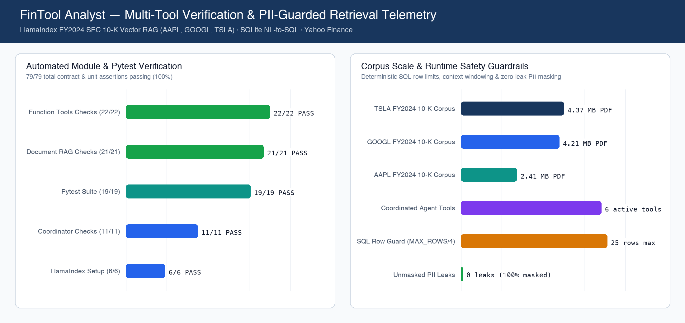
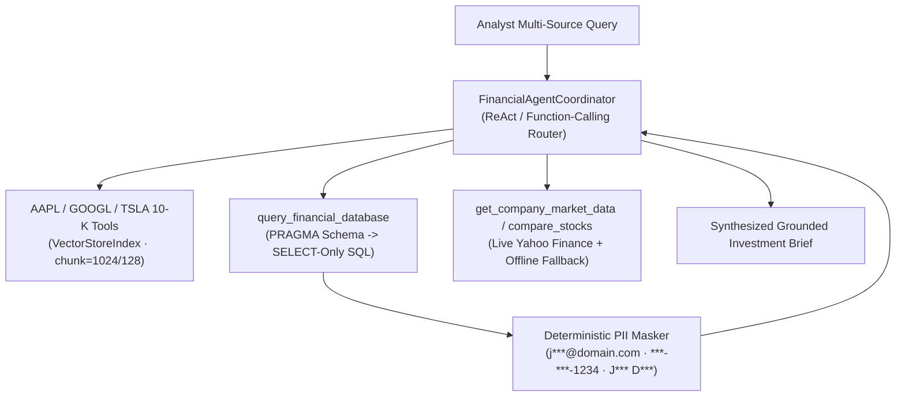

# FinTool Analyst: Multi-Tool SEC 10-K RAG, NL-to-SQL & PII-Guarded Equity Agent


Autonomous equity and portfolio research coordinator built with **LlamaIndex** and **OpenAI**—unifying **FY2024 SEC Form 10-K vector retrieval** (`AAPL`, `GOOGL`, `TSLA`), **schema-grounded read-only SQLite NL-to-SQL generation** (`MAX_ROWS = 25`), **live Yahoo Finance market telemetry**, and **pre-LLM PII redaction**.



---

## 1. Multi-Source Tool Routing & PII Interception Architecture



---

## 2. Sample PII-Masked SQL & Cross-Source Benchmark Trace

```text
$ python financial_agent.py --status
[OK] SEC 10-K Indices Ready: AAPL_10K_2024.pdf, GOOGL_10K_2024.pdf, TSLA_10K_2024.pdf
[OK] SQLite Database Connected: data/financial.db (clients, portfolios, holdings, transactions)
[OK] Active Tool Registry: 6/6 tools registered

# SQL PII Interception Example (Executed Before LLM Observation):
Raw DB Row:   {"client_name": "Jane Doe", "email": "jane.doe@example.com", "phone": "555-234-5678", "aum": 425000}
Masked Tool:  {"client_name": "J*** D***", "email": "j***@example.com",     "phone": "***-***-5678", "aum": 425000}
```

Full 26-cell interactive walkthrough with live SEC 10-K + SQL + market synthesis outputs: [`financial_agent_walkthrough.ipynb`](financial_agent_walkthrough.ipynb).

---

## 3. Quick Start

```bash
python3 -m venv .venv
source .venv/bin/activate
pip install -r requirements.txt
cp .env.example .env

python financial_agent.py --status
python financial_agent.py --benchmark
pytest tests/ -v
```

## License

MIT License — see [LICENSE](LICENSE).
